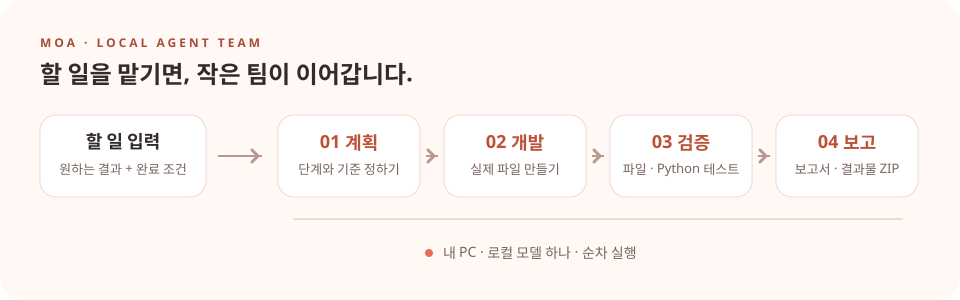

<p align="center"><a href="README.md">English</a> | <a href="README.ko.md">한국어</a></p>

<p align="center">
  
</p>
<h1 align="center">모아 · MOA</h1>
<p align="center"><strong>작은 팀이 차례대로, 당신의 일을 이어갑니다.</strong></p>
<p align="center">내 PC에서 실행하는 로컬 AI 에이전트 팀</p>
<p align="center">
  <a href="#빠른-시작">빠른 시작</a> &middot;
  <a href="docs/README.md">문서</a> &middot;
  <a href="docs/development.md">개발·검증 안내</a>
</p>

---

할 일과 완료 조건을 입력하면 **계획 → 개발 → 검증 → 보고**를 순서대로 진행합니다. 팀원들이 로컬 모델 하나를 공유하고, 대화와 결과물은 PC에 저장합니다.

<p align="center">
  
</p>

*역할별 협업을 표현한 일러스트입니다. 실제 에이전트 추론은 하나의 로컬 모델을 차례대로 사용합니다.*

<p align="center">
  
</p>

## 빠른 시작

**Windows x64 · Python 3.11 이상**이 필요합니다. 저장소를 내려받은 폴더에서 PowerShell로 실행해 주세요.

모델 설치 없이 먼저 체험하려면:

```powershell
.\Start.ps1 -Demo
```

앱이 실행되면 브라우저 주소창에 `http://127.0.0.1:8767`을 입력하세요. 팀 구성 저장 → 할 일 맡기기 → 결과 확인 순서로 체험합니다.
데모는 샘플 결과로 흐름을 보여주며, 실제 AI·Slack·VM에 연결하지 않습니다.

실제 로컬 AI를 사용하려면:

```powershell
.\Install.ps1 -DownloadModel
.\Start.ps1
```

앱이 실행되면 브라우저 주소창에 `http://127.0.0.1:8765`를 입력하세요. 기본 모델은 Qwen2.5-Coder-7B-Instruct Q4_K_M이며, 모델 다운로드에 약 4.68GB가 필요합니다. CPU로 한 번에 하나의 추론을 실행합니다.

종료는 `.\Stop.ps1`, 데모 종료는 `.\Stop.ps1 -Port 8767`입니다.

## 할 수 있는 일

- **내 팀 구성** — 1~8명, 이름·역할·추가 지침 설정
- **작업과 대화** — 담당자별 진행 상황, 내부 인계와 기록 확인
- **검증과 결과물** — 필수 파일·Python 테스트 확인, 실패 시 설정 한도 내 수정, 보고서·ZIP 다운로드
- **선택 연결** — Slack 지시·보고, 팀이 순서대로 사용하는 공유 VM

## 문서

### Slack 협업과 실제 VM 작업

Slack 설정에서 **Slack에서 팀원 협업·이미지 공유·실제 VM 작업 진행**을 켜세요. 팀원별 공개 계획·명령 결과·VM 화면을 작업 스레드에 전송하고, 전달이 확인된 뒤 다음 담당자가 이어받습니다. 봇을 각각 팀원에 배정할 수 있습니다.

실제 작업 명령은 번들 Tiny Core QEMU VM 안에서 실행하고, 게스트 출력과 종료 코드로 확인합니다. 결과 폴더는 `guest-workspace.tar.gz`로 보존하여 결과물 ZIP에 포함합니다. 이 모드에서는 호스트용 고정 Python 코드를 실행하지 않으며, 작업 내용에 게스트 검증 명령을 적어 주세요. 기본 텍스트 모델은 이미지를 공유하지만 시각적 내용을 해석하지는 않습니다.

Slack 가입·앱 설치 승인 후 `docs/slack-apps/`의 준비된 설정을 사용하세요. 토큰은 채팅 대신 이 PC 설정 화면에 입력합니다. 앱의 Slack 가이드에 연결 절차가 있습니다. `tools/verify_guest_live.py`는 실제 게스트 명령·결과 보존, `tools/verify_guest_model_live.py`는 실제 모델·VM·ZIP 대조를 확인합니다. 계정이 없는 Slack을 연결 성공으로 보고하지 않습니다.

[문서 모음](docs/README.md)에서 시작·팀 구성·모델·Slack·VM·백업·문제 해결 안내를 확인하실 수 있습니다. 실행 중에는 앱의 **사용 가이드**에서 스크린샷과 함께 읽으실 수 있습니다.

개발 환경 구성과 검증 명령, 상세 동작은 [개발·검증 안내](docs/development.md)에 정리했습니다.

테스트 파일은 [`tests/`](tests/)에 모았습니다. 저장소 루트에서 `python -m unittest -q`로 실행할 수 있습니다.

## 현재 범위

실제 코드 실행 검증은 **Python**을 대상으로 합니다. C#·C++ 컴파일러와 게임 엔진 검증은 연결하지 않았으며, 기본 모델은 비전 모델이 아닙니다. Slack은 계정 설정 후 연결해야 합니다.

Python 테스트는 현재 사용자 권한으로 실행되며 OS 보안 샌드박스가 아닙니다. VM·Slack의 실제 사용 범위와 운영 제한은 [상세 안내](docs/development.md)를 확인해 주세요.

### 이름을 가진 Slack 팀원 자동 연결
팀 설정 → Slack 연결에서 이름·프로필을 고르고 **팀원 봇 추가**를 누릅니다. 최초 Slack 권한 승인이 끝나면 공식 Slack CLI가 봇 생성·프로필·권한·접속 정보 발급을 처리하고 MOA가 DPAPI로 저장합니다. 토큰 복사는 필요하지 않습니다. 각 팀원은 별도 봇으로 업무 채널에서 대화와 VM 캡처를 주고받으며 상대의 수신·이미지 접근 확인 후 다음 VM 작업으로 진행합니다. 사용자와는 각 봇의 개별 DM을 사용합니다. Slack은 봇끼리의 DM을 cannot_dm_bot으로 거부합니다. 최초 CLI 로그인 정보는 사용자/SYSTEM 전용 폴더에 보관하며 백업에서 제외합니다. 복원 후 다시 인증하세요. 실제 Slack 검증은 사용자 승인 완료 후 `tools/verify_slack_team_live.py --run`으로 수행합니다.


### 시스템 트레이 실행

`모아 실행.vbs`를 더블클릭하거나 `./Start.ps1`을 실행하면 콘솔 없이 트레이에서 실행합니다. 더블클릭으로 관리 창, 우클릭으로 일시 중지·재개·종료를 사용할 수 있습니다. 기존 콘솔 실행은 `./Start.ps1 -Console`입니다. Windows 시작 시 자동 실행은 등록하지 않습니다.
