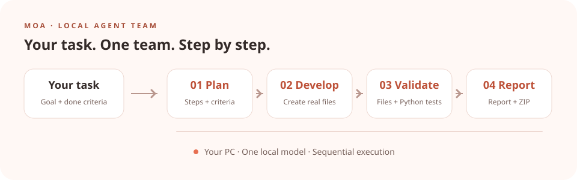

<p align="center"><a href="README.md">English</a> | <a href="README.ko.md">한국어</a></p>

<p align="center">
  
</p>
<h1 align="center">MOA · 모아</h1>
<p align="center"><strong>A small team, working together one step at a time.</strong></p>
<p align="center">A local AI agent team running on your PC</p>
<p align="center">
  <a href="#quick-start">Quick start</a> &middot;
  <a href="docs/README.md">Documentation (Korean)</a> &middot;
  <a href="docs/development.md">Development and validation (Korean)</a>
</p>

---

Describe your task and completion criteria. MOA works through **plan → develop → validate → report** in order. Team members share a single local model, and conversations and deliverables are stored on your PC.

<p align="center">
  
</p>

*An illustration of coordinated team roles. Agents take turns using one shared local model.*

<p align="center">
  
</p>

## Quick start

Requires **Windows x64 and Python 3.11 or later**. Run the following commands in PowerShell from the repository folder.

Try the demo without installing a model:

```powershell
.\Start.ps1 -Demo
```

Once the app starts, open `http://127.0.0.1:8767` in your browser. Save your team configuration, assign a task, and review the results.
The demo uses sample results to demonstrate the workflow; it does not connect to a real AI model, Slack, or a VM.

To use a real local AI model:

```powershell
.\Install.ps1 -DownloadModel
.\Start.ps1
```

Once the app starts, open `http://127.0.0.1:8765`. The default model is Qwen2.5-Coder-7B-Instruct Q4_K_M, which requires a download of approximately 4.68 GB. Inference runs on the CPU, one request at a time.

Stop the app with `.\Stop.ps1`, or stop the demo with `.\Stop.ps1 -Port 8767`.

## Features

- **Build your team** — Configure 1–8 members with names, roles, and additional instructions.
- **Tasks and conversations** — Follow each member's progress, internal handoffs, and activity history.
- **Validation and deliverables** — Check required files and Python tests, retry fixes within configured limits, and download reports and ZIP archives.
- **Optional integrations** — Send instructions and receive reports through Slack, or connect a shared VM used by team members in sequence.

## Documentation

### Slack collaboration and actual guest work

Enable **Slack collaboration, images and actual VM work** in Slack settings. Each teammate publishes a short public plan, command results and VM screenshots in the task thread. The next teammate waits for confirmed Slack delivery and image uploads. Separate bot connections can be assigned to individual teammates.

Actual guest tasks run model-selected shell commands inside the bundled Tiny Core QEMU VM, read its serial output and exit codes, and export the guest workspace as `guest-workspace.tar.gz` in the result ZIP. Host Python acceptance code is not used for this mode; describe guest checks in the task. The default text model shares images but does not interpret their visual content.

Create and authorize a Slack workspace/app first. Ready manifests are in `docs/slack-apps/`; enter tokens only in the local settings screen. See the in-app Slack guide for the connection steps. `tools/verify_guest_live.py` checks actual guest commands and export; `tools/verify_guest_model_live.py` checks actual model-to-guest work and ZIP readback. Neither script pretends an unconfigured Slack account is connected.

The [documentation index](docs/README.md) covers setup, team configuration, models, Slack, VMs, backups, and troubleshooting. While the app is running, its **User Guide (사용 가이드)** also provides instructions with screenshots. These guides are currently in Korean.

See [Development and validation](docs/development.md) for development setup, validation commands, and detailed behavior (Korean).

Tests are in [`tests/`](tests/). Run `python -m unittest -q` from the repository root.

## Current scope

Executable code validation currently targets **Python**. C# and C++ compilers and game engine validation are not integrated, and the default model does not support vision. Slack requires account configuration before use.

Python tests run with your current user permissions; they are not isolated by an OS security sandbox. See the [detailed guide](docs/development.md) for VM and Slack capabilities and operational limits (Korean).


## Prompt assistant and specialist roles

Refine a request into six fields, review it, then apply it before assigning the task. Configure each agent’s specialist role in Team Settings. See the [usage guide (Korean)](docs/prompt-assistant.md).
