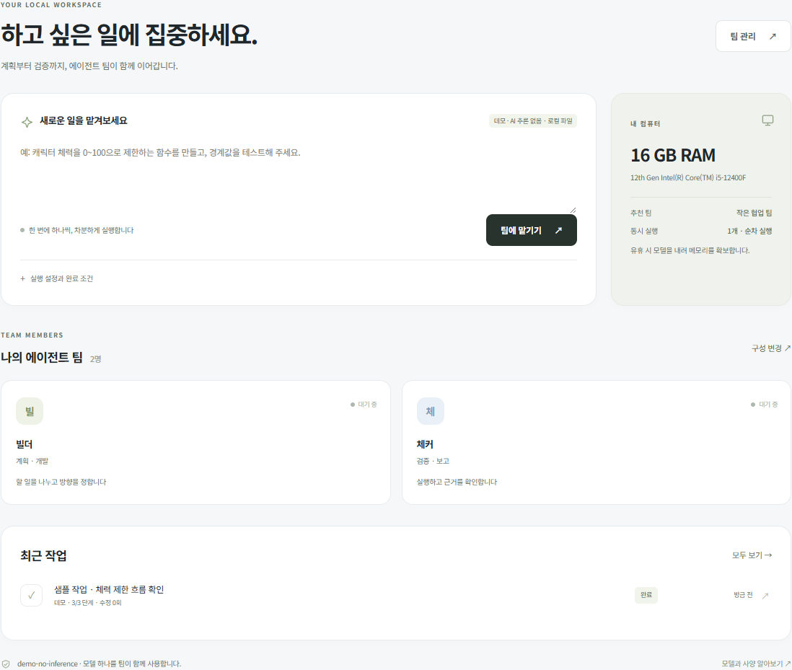

<!-- Generated from docs/models.html by tools/export_guides.cjs -->

[문서 모음](../README.md) · [프로젝트 소개](../../README.md)

# 내 PC와 로컬 모델

모델 하나를 모든 팀원이 공유합니다.

*체험용 데이터로 촬영 · 눌러서 크게 보기*

1. 내 컴퓨터의 RAM과 추천 팀을 확인하세요.
2. 처음에는 추천 구성으로 시작하세요.
3. 속도와 메모리를 확인한 뒤 모델·팀 구성을 조정하세요.

### 설치·사양·모델 안내

기본 모델은 **Qwen2.5-Coder-7B-Instruct Q4_K_M**입니다. llama.cpp를 사용해 CPU 4스레드와 단일 추론 슬롯으로 실행합니다. 현재 기본 구성은 GPU 가속을 사용하지 않습니다.

## 권장 구성을 보는 방법

팀 프리셋은 RAM에 따라 역할 분담과 실행 단계를 제안합니다. 모델 크기를 자동으로 바꾸지는 않습니다. 에이전트 수가 적어도 모델 하나가 사용하는 메모리는 필요합니다.

**검증한 PC**

i5-12400F · RAM 약 16GB · GTX 970 4GB에서 검증했습니다. 추론 중 가용 RAM이 약 0.42GB까지 줄어든 순간이 있었습니다. 작은 PC에서는 다른 무거운 앱과 함께 쓰기 어려울 수 있습니다.

## 쉬는 동안 메모리 확보

기본 설정은 300초 동안 새 요청이 없으면 모델과 관련 메모리를 내립니다. 다음 요청은 모델을 다시 올리므로 시작이 늦어집니다. 추론 캐시는 256MiB이며, config.json의 sleep_idle_seconds와 cache_ram_mib로 조정합니다.

## 속도에 대한 기대

이 PC의 7B 모델은 작은 코드 작업 두 개와 수정 시험에 약 8분 20초가 걸렸습니다. 이는 특정 시험 결과이며 다른 작업의 예상 시간을 보장하지 않습니다. 파일 수와 검증·수정 횟수가 늘면 더 걸립니다.

## 왜 작은 모델을 기본으로 쓰지 않나요?

먼저 시험한 1.5B 모델에서는 파일 누락과 구현·테스트 혼동이 재현됐습니다. 같은 기준을 통과한 7B를 기본으로 사용하고 있습니다. 설치 파일만 작다고 업무를 정확히 끝내는 것은 아니었습니다.

## VM이 필요한가요?

선택적으로 공유 VM 한 대를 사용합니다. 이 PC에서 RAM 512MB·CPU 1개인 Linux 데스크톱과 실제 모델의 순차 작업을 확인했습니다. 여러 Windows VM과 게임 엔진의 성능은 검증하지 않았습니다. 공유 VM 가이드에서 실행 범위와 사용법을 확인하세요.

모델 출처: [Qwen 공식 모델](https://huggingface.co/Qwen/Qwen2.5-Coder-7B-Instruct-GGUF) · 런타임: [llama.cpp](https://github.com/ggml-org/llama.cpp)

## 입력 길이 한도 오류

서버가 컨텍스트 한도 초과를 응답하면 최초 작업과 추가 지시를 작은 단위로 나누세요. 현재 context_size는 config.json의 모델 설정이며 팀원 수를 줄여도 입력 한도가 늘어나지는 않습니다. 값을 늘리는 고급 변경은 모델과 감독 프로세스를 다시 시작해야 적용되고 추가 RAM이 필요할 수 있습니다. 새 설정에서의 메모리·성능은 별도 검증 대상입니다.

## 설치가 끊겼을 때

`Install.ps1 -DownloadModel` 또는 `python src/install_model.py`를 다시 실행하세요. 남은 `.part` 파일부터 이어받고 공식 SHA-256이 일치한 뒤 정식 파일로 교체합니다. 서버가 이어받기를 지원하지 않으면 새로 내려받습니다. 범위가 잘못된 응답에서는 기존 파일을 보존하고 중단합니다. 해시가 맞지 않는 부분 파일은 지우며 다음 실행은 새 다운로드로 시작합니다.

설치는 한 번에 하나만 진행할 수 있습니다. 같은 파일을 이미 검증한 경우 다시 다운로드하지 않습니다. 런타임은 파일마다 임시 파일로 완성한 뒤 교체하고, 내용이 같은 DLL은 건드리지 않습니다. 설치 기록은 전체 설치 성공 후 갱신합니다. 여러 파일 전체를 한 번에 되돌리는 방식은 아니므로 중간 실패 후 같은 명령으로 다시 실행하세요. 재설치·수리 전에는 앱과 감시 관리자를 정상 종료해 사용 중인 실행 파일의 교체 오류를 피하세요. 설치가 끝나도 자동으로 모델 추론이나 VM을 실행하지 않습니다.

## VM·Slack 작업의 응답 지연

`compact_guest_prompts=true`는 VM 담당자에게 중복 조직 명부와 화면 표시용 정보를 전달하지 않고, 코드·일반 업무의 도구 안내를 간결하게 전달합니다. 원문 요청, 사용자 지침, 담당 범위, 활성 기술 지침, 실제 명령 결과와 독립 검증은 유지합니다. `false`는 기존 입력을 재현하는 A/B 검증용입니다.

`prestart_vm=true`이면 활성화된 공유 VM을 모델보다 먼저 준비합니다. VM의 RAM 검사 기준은 낮추지 않습니다. 준비 실패는 `data/vm-prestart.json`에 기록하고 설정 화면은 계속 실행합니다. 사용자 요청이 업무로 등록되기 전의 팀장·대화 대기도 배경 평가보다 우선합니다.
