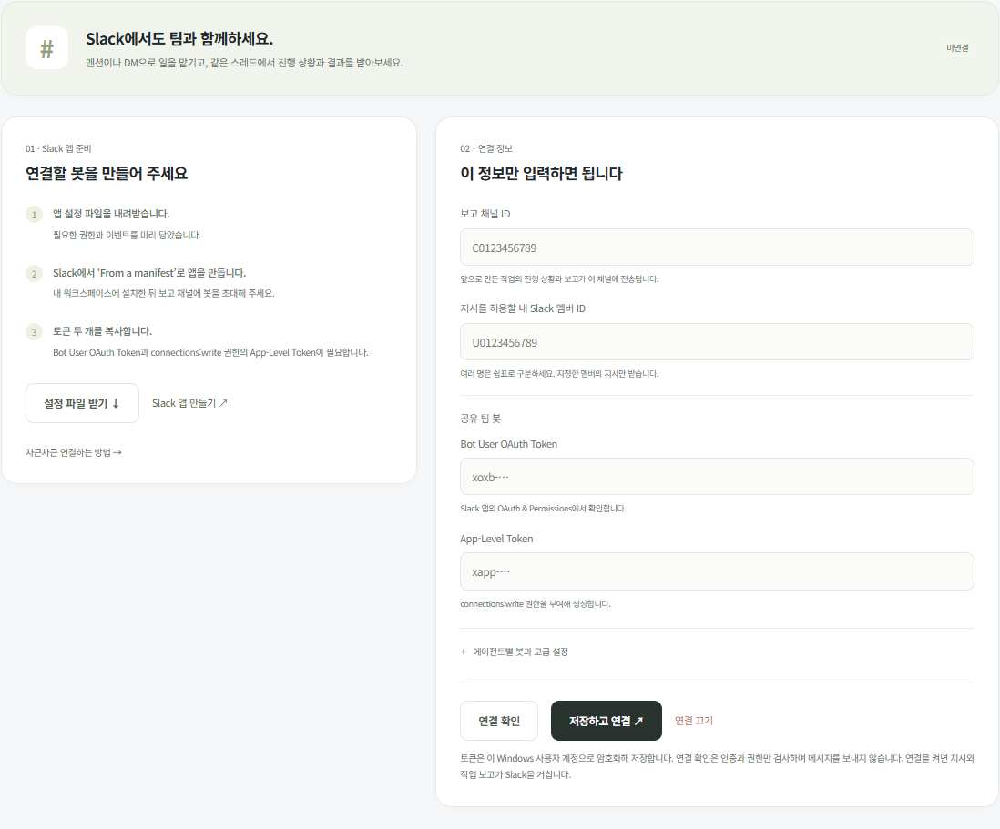

<!-- Generated from docs/slack.html by tools/export_guides.cjs -->

[문서 모음](../README.md) · [프로젝트 소개](../../README.md)

# Slack 연결하기

Slack은 필요할 때만 연결하세요.

[](../screenshots/slack.png)

*체험용 데이터로 촬영 · 눌러서 크게 보기*

1. **설정 파일 받기**로 Slack 앱을 준비하세요.
2. 채널 ID·허용 멤버 ID·토큰 두 개를 입력하세요.
3. 연결 확인 후 **저장하고 연결**을 누르세요.

### 봇 준비·연결 안내

PC가 켜져 있고 모아가 실행 중이면 Slack에서 일을 맡기고 결과를 받을 수 있습니다. 공개 웹서버 없이 Socket Mode를 사용합니다.

## 봇 하나로 시작하세요

기본 연결은 Slack 봇 하나가 팀 전체를 대표합니다. 메시지에는 ‘빌더 → 체커’처럼 실제 담당자를 표시합니다. 각각 별도 멘션 대상으로 만들려면 팀원별 Slack 앱을 추가해야 합니다.

## 1. 앱 설정 파일 받기

팀 설정 → Slack 연결에서 **설정 파일 받기**를 누릅니다. `moa-slack-app.json`에 필요한 봇 권한과 이벤트가 들어 있습니다.

## 2. Slack 앱 만들기

1. [Slack 앱 관리](https://api.slack.com/apps)에서 앱을 생성합니다.
2. **From a manifest**를 선택하고 워크스페이스를 정합니다.
3. 받은 JSON 내용을 붙여 넣고 권한을 검토한 후 생성합니다.
4. 워크스페이스에 앱을 설치합니다. 관리자의 승인이 필요한 조직에서는 먼저 승인을 받아 주세요.

## 3. 토큰 두 개 준비

- **Bot User OAuth Token:** OAuth & Permissions에서 `xoxb-`로 시작하는 토큰을 복사합니다.
- **App-Level Token:** Basic Information에서 `connections:write` 권한의 토큰을 생성합니다. `xapp-`로 시작합니다.

설정 파일은 Socket Mode와 app_mention·message.im 이벤트를 사용하도록 구성합니다. 앱 설정이 다르면 Socket Mode와 이벤트 구독도 확인하세요.

## 4. 채널과 내 멤버 ID 입력

보고 채널에 봇을 초대한 뒤 C로 시작하는 채널 ID를 입력하세요. 업무 지시를 허용할 U 또는 W로 시작하는 멤버 ID도 입력합니다. 지정하지 않은 멤버와 다른 봇의 메시지는 작업으로 실행하지 않습니다.

비공개 채널에는 별도 `groups:read` 권한이 필요할 수 있습니다. 기본 설정 파일은 공개 채널과 DM을 기준으로 최소 권한을 사용합니다.

## 5. 확인하고 연결

**연결 확인**은 봇 인증·채널 참여·Socket Mode 권한을 확인합니다. 테스트 메시지를 보내지는 않습니다. **저장하고 연결**을 누른 뒤 ‘연결됨’ 상태를 확인하세요. 토큰 저장 성공만으로 실제 연결 성공을 표시하지 않습니다.

## 업무 지시와 추가 지시

```
@내봇 health.py에 체력 제한 함수를 만들고 테스트해 주세요.
```

DM으로도 지시할 수 있습니다. 채널에서는 봇을 멘션해 주세요. 같은 작업 스레드에서 다시 멘션하면 진행 중 작업에 추가 지시를 기록합니다. 이미 끝난 스레드에서 새 지시를 하면 후속 작업을 만듭니다.

| 명령 | 동작 |
| --- | --- |
| 상태 | 현재 스레드 작업의 상태 보고 |
| 중지 | 작업 관리자 전체 일시 중지 |
| 계속 | 작업 관리자 재개 |
| 취소 | 현재 스레드 작업 취소 |

## 보고와 전송 범위

연결 이후 화면에서 만든 작업은 설정한 채널로 보고합니다. Slack에서 만든 작업은 지시한 스레드로 보고합니다. 과거 로컬 작업 기록을 한꺼번에 전송하지 않습니다.

전송 실패는 개발 작업과 분리해 재시도합니다. 네트워크가 전송 직후 끊어지면 Slack 메시지가 중복 표시될 가능성은 남습니다. 결과 파일 자체를 자동 업로드하지는 않습니다. ZIP은 이 PC의 화면에서 받으세요.

## 에이전트별 봇

고급 설정에서 봇 연결을 추가하고 담당 팀원을 선택합니다. 봇마다 앱과 토큰이 필요합니다. 연결된 역할에 맞춰 작업을 배정하며, 해당 팀원으로 표시되는 메시지는 그 봇으로 전송합니다. 개별 연결이 없으면 공유 봇 또는 지시를 받은 봇을 사용합니다.

공식 참고: [Socket Mode](https://docs.slack.dev/apis/events-api/using-socket-mode/) · [Python Slack SDK](https://docs.slack.dev/tools/python-slack-sdk/socket-mode/)

## 확인·저장 중 입력을 바꾼 경우

연결 확인을 기다리는 동안 정보가 바뀌면 이전 정보로 연결하지 않고 현재 입력으로 다시 확인하도록 안내합니다. 저장을 기다리는 동안 새로 수정한 정보는 미저장 상태로 유지합니다. 이미 저장된 토큰과 같은 입력은 지우고 저장 상태로 표시하며, 응답 대기 중 새로 입력한 다른 토큰은 보존합니다. 새 입력을 적용하려면 다시 연결 확인·저장하세요.

## 재시작과 재전송

진행 중 작업에 저장한 추가 지시는 이벤트 처리 완료 기록 전에 앱이 중단되어도 같은 이벤트를 다시 저장하지 않습니다. 그사이 작업이 완료되어도 재전송을 새 작업으로 만들지 않습니다. 알림 요청 ID는 설치 데이터별로 구분하고 재시작·백업 복원 후 유지합니다. 실제 Slack 서버의 중복 제거와 발송 성공은 별도 연결 검증이 필요합니다. 상태·일시 중지·재개·취소 명령은 현재 상태 확인, 제어 변경, 응답 대기열과 이벤트 처리 기록을 하나로 저장합니다. 저장 중 실패하면 함께 되돌리고, 같은 이벤트를 다시 받아도 수동 재개를 과거 중지 명령으로 덮어쓰지 않습니다. 두 수신기가 같은 명령을 받는 경우도 같은 로컬 데이터베이스의 처리 기록으로 구분합니다.

## 복원한 대기 항목

백업을 복원하면 당시 대기 중이던 알림과 수신 지시는 보류합니다. 연결을 다시 켜는 것만으로 이 항목을 처리하지 않습니다. Slack 설정의 **복원한 대기 항목 확인**에서 내용을 읽고 항목을 선택해 재개하거나 제외하세요. 종류별 20개씩 표시하며 처리 후 다음 목록을 불러옵니다. 제외한 내용과 처리 이력은 데이터에 남습니다. 재개한 지시는 새 작업·제어 명령으로 처리될 수 있고 알림은 Slack으로 전송될 수 있습니다. 작업 관리자 일시 중지는 이 버튼으로 자동 해제하지 않지만, 재개한 수신 항목 자체가 재개 명령이면 그 명령을 처리합니다. 복원 후 새로 도착한 지시에는 별도 보류가 적용되지 않습니다.

## 일시 중지와 작업 없는 명령

일시 중지는 단계 사이에서 실행을 대기시키며 새 업무 지시는 대기열에 접수합니다. 이미 진행 중인 동작을 즉시 중단하는 기능은 아닙니다. 연결된 작업이 없는 스레드의 상태·취소 명령은 새 AI 작업을 만들지 않습니다. 작업 상태 응답은 조회 당시 상태이며 실제 Slack 발송은 별도 대기열에서 처리합니다.
