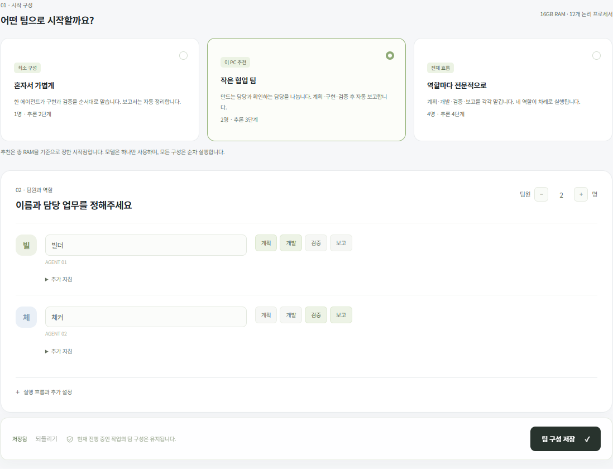

<!-- Generated from docs/team.html by tools/export_guides.cjs -->

[문서 모음](../README.md) · [프로젝트 소개](../../README.md)

# 에이전트 팀 구성

추천 구성으로 시작하고 필요한 역할만 바꾸세요.

*체험용 데이터로 촬영 · 눌러서 크게 보기*

1. 이 PC 추천 구성을 선택하세요.
2. 팀원 수·이름·담당 역할을 정하세요.
3. **팀 구성 저장**을 누르세요. 새 작업부터 적용됩니다.

### 세부 설정

저장된 팀 설정을 읽지 못하면 복구 안내와 기본 구성을 표시하고 새 작업 접수를 보류합니다. 원하는 팀을 확인해 저장하면 손상된 원문을 DB의 별도 이력에 보관하고 복구합니다. 기존 작업은 접수 당시 팀을 유지합니다. 안내가 계속되면 데이터를 백업하고 확인하세요.

사양을 읽지 못해도 팀은 직접 구성할 수 있습니다. 실패하거나 잘못된 측정값은 미확인으로 표시하며, 필요한 사양이 미확인이면 공유 VM 자동 추천을 보류합니다. 여유 RAM 0은 측정 실패와 구분합니다.

팀원은 각자 이름·담당 역할·추가 지침을 가집니다. 실제 모델은 하나를 공유하고 순서대로 작업합니다. 팀원 수를 늘린다고 모델을 여러 개 메모리에 올리지는 않습니다.

## 추천 프리셋

| 구성 | 팀원 | 실행 흐름 |
| --- | --- | --- |
| 혼자서 가볍게 | 1명 | 개발 → 검증 → 자동 보고 |
| 작은 협업 팀 | 2명 | 계획 → 개발 → 검증 → 자동 보고 |
| 역할마다 전문적으로 | 4명 | 계획 → 개발 → 검증 → 보고 |

총 RAM 12GB 미만은 1명, 12~24GB 미만은 2명, 24GB 이상은 4명을 시작점으로 제안합니다. 이는 구성 제안이며 모든 PC에서의 성능을 검증한 기준은 아닙니다. 특히 모델 메모리 요구량은 별도로 확인해야 합니다.

**팀원 수와 추론 단계는 다릅니다.**

한 팀원이 여러 역할을 맡을 수 있습니다. 가벼운 흐름은 별도 계획·보고 추론을 줄입니다. 실제 호출 횟수는 파일 수와 수정 횟수에 따라 늘어날 수 있습니다.

## 내 팀으로 바꾸기

1. 프리셋을 선택합니다.
2. 팀원 수를 1~8명으로 조정합니다.
3. 각 팀원의 이름과 역할을 정합니다. 역할은 여러 개 선택할 수 있습니다.
4. 필요하면 ‘추가 지침’에 말투나 업무 원칙을 입력합니다.
5. 팀 구성을 저장합니다.

## 역할별로 하는 일

- **계획:** 기능을 단계로 나누고 완료 기준과 필요한 파일을 정합니다.
- **개발:** 코드와 문서를 실제 파일로 작성합니다.
- **검증:** 파일·테스트·실행 근거를 확인하고 수정 요청을 보냅니다.
- **보고:** 확인한 결과와 미확인 사항을 설명합니다. 이 단계를 생략해도 보고서와 ZIP은 자동으로 생성됩니다.

개발 다음에는 검증 단계가 반드시 있어야 합니다. 같은 역할을 맡은 팀원이 여러 명이면 작업별로 배분됩니다. 여러 에이전트가 같은 프로젝트를 동시에 수정하지 않습니다.

## 언제 적용되나요?

저장 이후 만든 작업부터 적용됩니다. 기존 작업은 생성할 때의 팀과 역할 배정을 보존하므로 이름이나 인원 변경으로 실행 도중 담당자가 바뀌지 않습니다.

팀원이 한 명이면 구현과 검증을 같은 에이전트가 맡습니다. 서로 다른 판단의 독립성을 보장하지 않으므로, 중요한 작업에는 고정 테스트를 추가하세요.

## 역할이 겹치는 팀원의 배정

새 작업에서는 같은 작업 안에서 배정된 단계가 적은 팀원을 우선합니다. 가능한 경우 검증은 개발 담당과 다른 팀원에게 맡깁니다. 한 명 팀이나 해당 역할을 할 수 있는 팀원이 한 명뿐이면 같은 팀원이 순서대로 진행합니다. 이미 등록한 작업의 배정은 변경하지 않으며, 실제 Slack에서 특정 팀원에게 직접 맡기는 지시는 그 팀원의 역할 배정을 우선할 수 있습니다. 작업량·단계 수를 기준으로 한 간단한 배정이며 실제 작업 시간 예측은 하지 않습니다.

## 저장하는 동안 계속 수정한 경우

팀·VM 환경 저장은 누른 시점의 값을 저장합니다. 응답을 기다리는 동안 내용을 더 수정하면 새 입력은 미저장 상태로 유지하고, 전송한 구성이 저장됐다고 안내합니다. 새 입력까지 적용하려면 다시 저장하세요. 다른 창과의 저장 충돌은 현재 입력을 유지한 채 최신 버전을 확인하도록 안내합니다.
